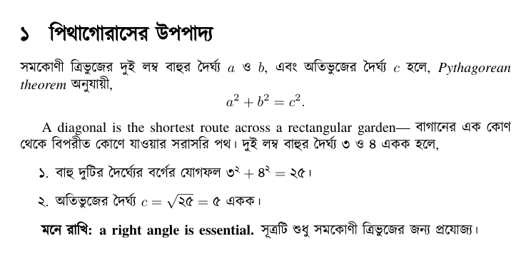
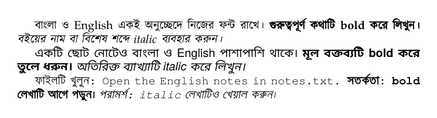
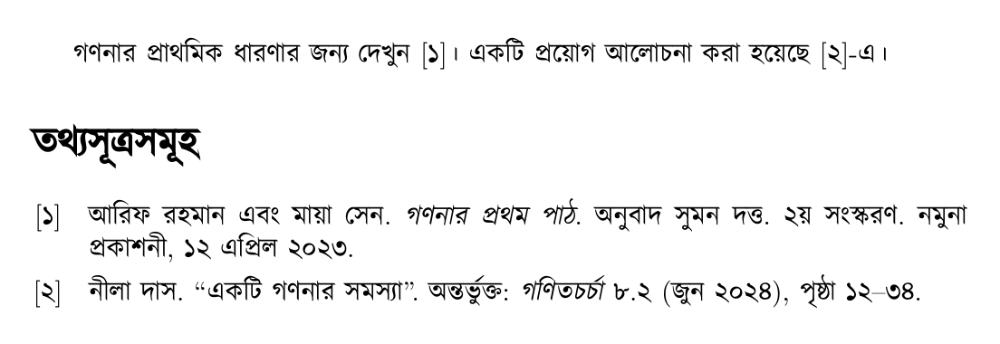

<p align="center">
  
</p>

<p align="center">Writing Bangla &amp; Assamese with ordinary LaTeX</p>

Write Bangla or Assamese with the LaTeX commands you already
know. Mix English into the same paragraph: LaTeXbangla switches fonts automatically,
handles bold and italic, and preserves your chosen English and math fonts.

You also get native numbering, lists with ১, ২, ৩ and ক, খ, গ, translated reference
names, localized bibliographies with biblatex or natbib, and Bangla or Assamese text and digits inside equations.
Tested with **XeLaTeX and LuaLaTeX** and **25 font families in both languages**.

LaTeXbangla is free to use. If you use it to publish a book, please consider acknowledging
the package and its author, Adib Hasan. :))

Manual: [English](latexbangla/latexbangla.pdf#nameddest=guide-english) · [বাংলা](latexbangla/latexbangla.pdf#nameddest=guide-bangla) · [অসমীয়া](latexbangla/latexbangla.pdf#nameddest=guide-assamese) · [Bangla example](examples/bangla.pdf) · [Assamese example](examples/assamese.pdf)

Writing a book? Check out [BOOKbangla](https://github.com/Neehan/BOOKbangla), a companion book class built on memoir and LaTeXbangla for Bangla and Assamese books.

## Get started

**Using Overleaf?** Make a copy of the [demo project](https://www.overleaf.com/project/6adbaac1d48d9344680c2fe1/share#6b9d2d41b2de0b80c2de0d11c68ce7c79f33cbe1edef7ec7) to get started with the latest version.

Copy the contents of [`latexbangla/`](latexbangla/) beside your document, keeping the subfolders intact. Install one Bangla font and
compile with **XeLaTeX or LuaLaTeX** on an updated TeX Live 2024 or later.

**Tested fonts for both languages:** Kalpurush, SolaimanLipi, Siyam Rupali, Noto Serif Bengali,
Noto Sans Bengali, Anek Bangla, Tiro Bangla, Galada, Hind Siliguri, Nikosh,
Kohinoor Bangla, Mukti, Baloo Da 2, Lohit Bengali, Jamrul, Likhan, Shimanto, Mina,
AdorshoLipi, BenSen, BenSenHandwriting, Atma, Alkatra, Shonar Bangla, and FreeSerif.
[Compare the fonts](examples/supported-fonts.pdf). Jamrul 0.1 and Likhan 0.6 lack ৎ (U+09CE).
Other Bangla fonts may work too, but have not been tested.
Use your chosen font name or filename in `\setbanglamainfont`; for the Anek and
Alkatra variable fonts, follow the filename examples in the font guide.

```latex
\documentclass{article}
\usepackage{latexbangla}
\setbanglamainfont{Kalpurush}
\setmainfont{TeX Gyre Termes} % Optional: change the English font.

\begin{document}
\section{পিথাগোরাসের উপপাদ্য}
সমকোণী ত্রিভুজের দুই লম্ব বাহুর দৈর্ঘ্য $a$ ও $b$,
এবং অতিভুজের দৈর্ঘ্য $c$ হলে, \textit{Pythagorean theorem} অনুযায়ী,\footnote{সমকোণের বিপরীত বাহুটিই অতিভুজ বা hypotenuse।}
\[a^2+b^2=c^2.\]

A diagonal is the shortest route across a rectangular garden—
বাগানের এক কোণ থেকে বিপরীত কোণে যাওয়ার সরাসরি পথ।
দুই লম্ব বাহুর দৈর্ঘ্য ৩ ও ৪ একক হলে,
\begin{enumerate}
  \item বাহু দুটির দৈর্ঘ্যের বর্গের যোগফল $৩^{২}+৪^{২}=২৫$।
  \item অতিভুজের দৈর্ঘ্য $c=\sqrt{২৫}=৫$ একক।
\end{enumerate}

\textbf{মনে রাখি: a right angle is essential.}
সূত্রটি শুধু সমকোণী ত্রিভুজের জন্য প্রযোজ্য।
\end{document}
```



For Assamese documents, load `\usepackage[language=assamese]{latexbangla}`.
Keep using the same font commands; Bangla is the default language.
[Assamese example](examples/assamese.pdf) · [Source](examples/assamese.tex)

## Choose separate font families

For more control, give main, sans and mono text their own Bangla/English font pairs.
Install Noto Sans Bengali and Siyam Rupali alongside Kalpurush, then use ordinary
commands such as `\textsf` and `\texttt`; each script keeps its chosen font:

```latex
\documentclass{article}
\usepackage{latexbangla}
\setbanglamainfont{Kalpurush}
\setmainfont{TeX Gyre Pagella}
\setbanglasansfont{Noto Sans Bengali}
\setsansfont{TeX Gyre Heros}
\setbanglamonofont{Siyam Rupali}
\setmonofont{TeX Gyre Cursor}

\begin{document}
বাংলা ও English একই অনুচ্ছেদে নিজের ফন্ট রাখে।
\textbf{গুরুত্বপূর্ণ কথাটি bold করে লিখুন।}
\textit{বইয়ের নাম বা বিশেষ শব্দে italic ব্যবহার করুন।}

\textsf{একটি ছোট নোটেও বাংলা ও English পাশাপাশি থাকে।
\textbf{মূল বক্তব্যটি bold করে তুলে ধরুন।}
\textit{অতিরিক্ত ব্যাখ্যাটি italic করে লিখুন।}}

\texttt{ফাইলটি খুলুন: Open the English notes in notes.txt.
\textbf{সতর্কতা: bold লেখাটি আগে পড়ুন।}
\textit{পরামর্শ: italic লেখাটিও খেয়াল করুন।}}
\end{document}
```



## Cite sources in Bangla

Use biblatex or natbib for citations and bibliographies with translated terms,
dates and numbers. Here is a biblatex example using two sample entries in `references.bib`:

```bibtex
@book{book,
  author = {আরিফ রহমান and মায়া সেন},
  title = {গণনার প্রথম পাঠ},
  translator = {সুমন দত্ত},
  edition = {2},
  publisher = {নমুনা প্রকাশনী},
  date = {2023-04-12}
}
@article{article,
  author = {নীলা দাস},
  title = {একটি গণনার সমস্যা},
  journaltitle = {গণিতচর্চা},
  volume = {8}, number = {2},
  pages = {12-34}, date = {2024-06}
}
```

```latex
\documentclass{article}
\usepackage{latexbangla}
\setbanglamainfont{Kalpurush}
\usepackage[backend=biber,style=numeric-comp,sorting=none,date=long]{biblatex}
\addbibresource{references.bib}

\begin{document}
গণনার প্রাথমিক ধারণার জন্য দেখুন \cite{book}।
একটি প্রয়োগ আলোচনা করা হয়েছে \cite{article}-এ।
\printbibliography
\end{document}
```

Compile with XeLaTeX or LuaLaTeX, run Biber, then compile twice more.



Assamese works the same way with `language=assamese`. For natbib, use
`plainnatbn`, `abbrvnatbn` or `unsrtnatbn`; see the [manual](latexbangla/latexbangla.pdf).

[Report a bug](https://github.com/Neehan/LaTeXbangla/issues) ·
[latexbangla@googlegroups.com](https://groups.google.com/g/latexbangla) ·
[Contributing](CONTRIBUTING.md)

By [Adib Hasan](https://adibhasan.com) · [LPPL 1.3c or later](LICENSE)
